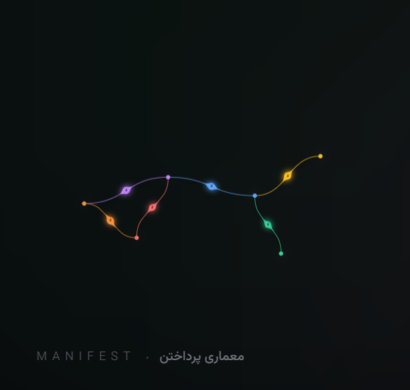

# معماریِ پرداختن | Architecture of Inhabiting / Paying Attention
> **گراف تعاملی و نگاشت مفهومی مقاله منتشرشده در نشریه «دریچه دوازدهم»**  
> **دانشکده معماری، پردیس هنرهای زیبای دانشگاه تهران**

---

## 📌 درباره اثر (About the Project)

این پروژه، وب‌اپلیکیشن تعاملی و بستر دیجیتال مقاله **«معماریِ پرداختن»** است که برای شماره دوازدهم نشریه تخصصی معماری «دریچه» طراحی و توسعه یافته است. هدف این گراف، تبدیل مفاهیم متنی مقاله به یک **شبکه زنده، پویا و مکاشفه‌آمیز** است تا مخاطب بتواند پیوند ارگانیک میان اندیشه‌ها، بحران‌ها و افق‌های آینده معماری را تجربه کند.

* **نویسنده و طراح ایده:** محمدحسن سهرابی بیدار (دانشجوی کارشناسی ارشد معماری، دانشگاه تهران)
* **نشریه:** دریچه ۱۲ — پاییز ۱۴۰۴ / بهار ۱۴۰۵
* **ناشر:** انجمن علمی معماری، پردیس هنرهای زیبا، دانشگاه تهران

---

## 🧭 ارکان و گره‌های شبکه مفهومی (Core Nodes)

گراف از ۶ گره کلیدی با پیوندهای چندلایه و روابط علّی-معنایی تشکیل شده است:
1. **هسته مانیفست (Manifesto Core):** خاستگاه اراده، معنا و مسئولیت وجودی معمار.
2. **هندسه معرفتی (Epistemic Geometry):** تبلور نظام ذهنی و ادراک فضایی در قالب فرم و ساختار.
3. **رابط کاربری (User Interface / Affordance):** نقطه اتصال تجربه زیسته انسان با کالبد معماری.
4. **آسیب‌شناسی (Pathology):** کالبدشکافی عوارض فرم‌های گسسته از واقعیت و بحران‌های معاصر.
5. **آینده و مسئولیت (Future & Responsibility):** سهم معماری در تولید رخداد واقعیت و تعهد به زیست‌بوم.
6. **طبیعت و بستر (Nature & Context):** سرچشمه و زمینه تاریخی-طبیعی شکل‌گیری فضا.

---

## 🛠 ویژگی‌های فنی و طراحی بصری (Technical Features)

- **گراف کاملاً استاتیک و سبک (کمتر از ۷۵۰ کیلوبایت):** بدون نیاز به سرور یا دیتابیس، با لود سریع در کمتر از نیم ثانیه.
- **مستقل از تحریم و فیلترینگ:** بدون استفاده از CDNهای مسدود خارجی؛ کلیه دارایی‌ها (کتابخانه `Vis.js` و فونت‌های فارسی `Vazirmatn`) به صورت محلی بارگذاری می‌شوند.
- **طراحی ریسپانسیو دوگانه (Dual Viewport Architecture):**
  - حالت دسکتاپ: چیدمان افقی و متوازن با باز شدن سایدبار جزئیات.
  - حالت موبایل: چیدمان عمودی بهینه‌شده به همراه انیمیشن مینیمال آکاردئونی و ژست لمسی (Swipe-to-Dismiss).
- **فیزیک ارتعاش کشسانی و موجی (Elastic Chord Pulse):** شبیه‌سازی فیزیک طناب و انتشار موج میرا شونده به محض کلیک بر روی گره‌ها.
- **غلاف‌های میان‌مسیر (Pod Nodes) با نشانگرهای مرواریدی:** نمایش توالی خوانش قطعات مقاله با نقاط نورانی مماس.
- **توزیع و نفوذ رنگی عمیق (Radial Color Diffusion):** ادغام ملایم رنگ‌های هر مسیر در کانون گره‌ها بدون مرزهای تیز.

---

## ⚖️ حقوق مالکیت فکری و حق نشر (Intellectual Property & Copyright)

کلیه حقوق مادی، معنوی و مالکیت فکری مربوط به:
- محتوا و متن مقاله
- دیاگرام و نگاشت مفهومی روابط گره‌ها
- معماری گراف و هویت بصری
- کدهای منبع سفارشی‌سازی‌شده

متعلق به **محمدحسن سهرابی بیدار** و نشریه **دریچه دوازدهم (دانشگاه تهران)** می‌باشد.

این اثر تحت لایسنس **[Creative Commons CC BY-NC-ND 4.0](LICENSE)** منتشر شده است:
- استفاده غیرتجاری صرفاً با ذکر کامل نام پدیدآورنده و ارجاع به نشریه دریچه مجاز است.
- هرگونه تغییر، بازتولید ناقص، کپی‌برداری تجاری یا فروش بخش یا کلیت این طرح بدون اجازه کتبی مؤلف ممنوع بوده و مشمول قوانین حمایت از حقوق مؤلفان و مصنفان می‌گردد.

---

## 📬 ارتباط و ارجاع (Citation & Contact)

- **نویسنده:** محمدحسن سهرابی بیدار
- **ایمیل:** Mhsoh17@gmail.com
- **دانشگاه:** دانشکده معماری، پردیس هنرهای زیبا، دانشگاه تهران
